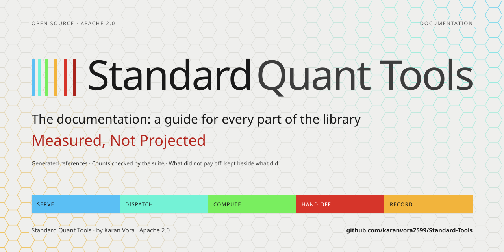

<picture>
  <source media="(prefers-color-scheme: dark)" srcset="assets/docs-banner-dark.svg">
  
</picture>

**The guides to Standard Quant Tools, one for every part of the library.** Each says what its part does, how it fails, and what it was measured to do, the ports and rules that did not pay off included. Two are generated from the live registries, and the counts in the rest are checked by tests that fail when they go stale.

New here? Start with the [README](../README.md), then the [module reference](00_module_reference.md) for the API and the [tool index](20_tool_index.md) for what an agent sees. For the whole library in one document, read the briefing, a 40-page PDF in [light](Standard-Quant-Tools-Briefing.pdf) or [dark](Standard-Quant-Tools-Briefing-Dark.pdf).

##  Start here

The map: every module's API, the runtimes an agent is served, and every tool with the description the model reads.

| Guide | What it covers |
|---|---|
| [00 · Module reference](00_module_reference.md) | Every public module's API surface in one place |
| [19 · Runtimes and the Handoff Interconnect](19_runtimes.md) | The twelve parallel runtimes and why scoping is enforced at dispatch rather than advertised; the typed handoff references that carry bulk values between them; pre-flight tool validation |
| [20 · Tool index](20_tool_index.md) | **Generated** index of all 266 tools by runtime, with the description the model sees and every argument name |

##  Data

Getting the bytes, saying what they can support, and when each fact became knowable.

| Guide | What it covers |
|---|---|
| [01 · Data Fetching](01_data_fetching.md) | Data providers, Parquet cache, error handling |
| [26 · The Data Runtime](26_data.md) | The data runtime: fetching as a reference other runtimes read, what a provider guarantees, temporal contracts for frames this library did not fetch, bundles, and the unit-versus-definition distinction in ratio comparison |
| [11 · Data Quality](11_data_quality.md) | Dataset provenance metadata, missing-bar/stale-price/price-jump detection |
| [14 · Polars Support (optional)](14_polars_support.md) | Optional Polars interop (`pip install standard_quant_tools[polars]`): what's supported today, the conversion-boundary design, and what is not adapted yet |

##  Research and statistics

Indicators, metrics and the statistical structure of a return series, with error bars.

| Guide | What it covers |
|---|---|
| [02 · Technical Indicators](02_indicators.md) | All 14 technical indicators with examples |
| [03 · Metrics](03_metrics.md) | Risk/return metrics (VaR, Sharpe, Calmar, …) |
| [08 · Analysis](08_analysis.md) | Multi-factor regression, cointegration, PCA, Hurst exponent (incl. C++ acceleration) |
| [23 · Statistical inference and diagnostics](23_inference.md) | Error bars and diagnostics: block bootstrap intervals, distribution comparison, normality and tail index, Sharpe stability, drawdown profile, seasonality, lead-lag, structural breaks |

##  Instruments and markets

Options, the instruments that move one-for-one, and what the market charges to trade.

| Guide | What it covers |
|---|---|
| [12 · Options Pricing, Greeks & Implied Volatility](12_options.md) | Black-Scholes-Merton option pricing, Greeks, implied volatility (European options only) |
| [21 · Derivatives](21_derivatives.md) | The derivatives runtime: second-order greeks, multi-leg payoffs, smile and term-structure fitting with arbitrage checks, put-call parity, delta-hedge simulation, revaluation grids |
| [28 · Delta One](28_delta_one.md) | Carry and basis against a quoted future, futures curves and roll economics, beta translated into contracts, and why the holding horizon reverses which instrument is cheapest |
| [22 · Microstructure](22_microstructure.md) | The microstructure runtime: spreads measured from ticks, and the eight bar-based estimators (Roll, Corwin-Schultz, Amihud, Kyle, order flow, VPIN, volume profile, implementation shortfall) for when there is no tick feed |

##  Modeling

Walk-forward-validated models, and the generated catalog of everything they can be built from.

| Guide | What it covers |
|---|---|
| [15 · Modeling Runtime (`standard_quant_tools.modeling`)](15_modeling.md) | The separate 38-tool modeling runtime: feature catalog and feature report, regression/classification/ranking/survival targets, leakage-purged walk-forward validation, sample weighting, the model adapters, point-in-time joins, the content-addressed model registry with signed manifests, lifecycle stages and drift monitoring, the model→backtest bridge, portfolio evaluation of OOS predictions, and what's explicitly deferred |
| [29 · Modeling reference](29_modeling_reference.md) | **Generated** from the modeling registries: every feature, estimator (with bounded parameters and capabilities), target and spec option; a test fails when it drifts |

##  Backtesting

Whether a strategy works, and how much of the result is real.

| Guide | What it covers |
|---|---|
| [04 · Backtesting](04_backtesting.md) | Vectorized engine, trade log, custom signals, grid search |
| [24 · Overfitting and trade analysis](24_overfitting.md) | How much of a backtest is real: deflated Sharpe, PBO, purged combinatorial CV, reality check, Monte Carlo trade paths, trade clustering, break-even cost |
| [06 · Stock Screener](06_screener.md) | Filter reference, large-universe screening, example screens |

##  Portfolio and capital

Turning a view into positions, capital across return streams, and what holding them costs.

| Guide | What it covers |
|---|---|
| [05 · Portfolio Analysis](05_portfolio.md) | Multi-asset metrics, correlation, optimization |
| [31 · Capital Allocation](31_allocation.md) | The allocation runtime: return streams on one calendar, allocating across sleeves with how much of the split the sample chose, the walk-forward test of an allocation rule, Kelly leverage, volatility-target and CPPI overlays, the capacity curve, Brinson attribution and time- against money-weighted returns |
| [32 · Finance](32_finance.md) | The finance runtime: financing and borrow on positions, Reg T and FINRA 4210 margin and the margin runway under a stress path, currency exposure after hedges, carry, the FX forward by covered interest parity, and NPV, IRR, duration, cost of capital and DCF |

##  Agents and MCP

The LLM surface: the tools, how agents are routed and orchestrated, and the MCP server.

| Guide | What it covers |
|---|---|
| [07 · Agent Tools](07_agent_tools.md) | Core 14 LLM tools, the full 217-tool analysis registry, Pydantic models, end-to-end agent loop |
| [09 · Advanced Agent Tools](09_advanced_agent_tools.md) | 35 advanced/supplementary/custom-signal/analytics/options/diagnostic tools: regime-adaptive (full-sample and leakage-free walk-forward), pair scanner, walk-forward, risk attribution, portfolio optimization, constrained optimization with shadow prices, factor and tail risk decomposition, position sizer, fundamentals, optimization, advanced indicators, rolling beta, extended risk, backtest diagnostics, true portfolio simulation, pair trade backtest, robustness diagnostics, capacity report, data quality report, compact backtest result, volatility estimators, correlation analysis, Monte Carlo simulation, stress test, liquidity metrics, GARCH volatility forecast, Kalman hedge ratio, EVT tail risk, option pricing/Greeks, implied volatility |
| [13 · Agent Orchestration](13_agent_orchestration.md) | Tool-category taxonomy, the lightweight router, and the multi-agent orchestrator-workers architecture |
| [18 · MCP server](18_mcp.md) | The MCP server: install, runtime and category scoping, the context budget, resources, prompts, and the audit trail over the protocol |
| [27 · The Meta Runtime](27_meta.md) | The meta runtime: pre-flight (`describe_tool`, `validate_tool_call`), registry discovery, what a provider can promise, reading published artifacts, and the read-only half of the audit trail |

##  Trust

What a decision record proves, the audits and what they found, and the tests that keep it so.

| Guide | What it covers |
|---|---|
| [10 · Auditability](10_auditability.md) | Decision-record audit trail, replay verification (both tool registries), correlated logging, `sqt` CLI |
| [17 · Correctness & Backend Parity](17_correctness.md) | The correctness audits and the backend-parity contract between the Python and C++ tiers |
| [25 · The testing regime](25_testing.md) | The nine-layer testing regime: planted-answer correctness, a second oracle per C++ kernel, the whole-suite run with the extension switched off, whole-surface invariants, schema-synthesized adversarial fuzzing, metamorphic relations, determinism and purity, generated documentation, and mutation testing — with what each layer has actually caught |

##  Speed and the build

Every measured speedup beside the ports that did not pay off, and building the extension.

| Guide | What it covers |
|---|---|
| [16 · Performance](16_performance.md) | Every measured C++ and Python-level performance figure, with methodology and the ports that did not pay off |
| [30 · C++ Extension Build Guide](30_build_guide.md) | C++ extension build instructions (Windows / Linux / macOS) |

How the images on these pages are made, and how to rebuild them: [design/README.md](design/README.md).

---

[Standard Quant Tools](../README.md) · by Karan Vora · Apache 2.0
